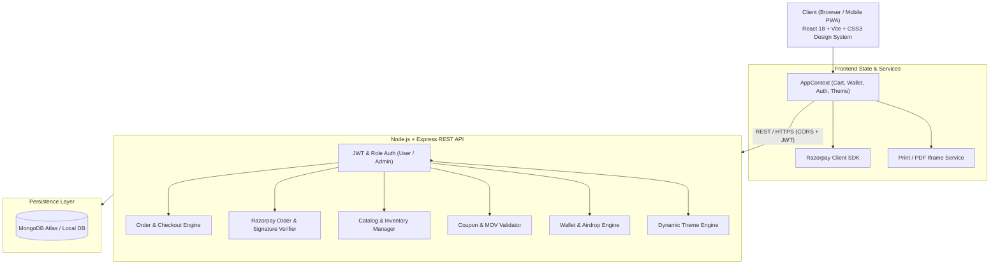

# ⚡ QuickCart — 10-Minute Instant E-Commerce Superstore

[](https://react.dev/)
[](https://vitejs.dev/)
[](https://nodejs.org/)
[](https://expressjs.com/)
[](https://www.mongodb.com/)
[](https://razorpay.com/)
[](https://www.netlify.com/)
[](LICENSE)

> A modern, full-stack, hyper-local quick-commerce web application inspired by **Blinkit**, **Zepto**, and **Swiggy Instamart**. Features 10-minute order flows, Razorpay checkout, live public order tracking, dynamic store theme engine, promotional wallet cash airdrops, coupons with MOV validation, printable GST tax invoices, and an enterprise-grade admin management suite.

---

## 🌟 Table of Contents
- [✨ Key Features](#-key-features)
- [🏗️ System Architecture](#️-system-architecture)
- [🛠️ Tech Stack](#️-tech-stack)
- [📁 Project Structure](#-project-structure)
- [🚀 Quick Start (Local Setup)](#-quick-start-local-setup)
- [🔐 Environment Variables](#-environment-variables)
- [📡 API Endpoints](#-api-endpoints)
- [📱 Responsive Design & Touch Ergonomics](#-responsive-design--touch-ergonomics)
- [☁️ Deployment Guide](#️-deployment-guide)
- [👤 Author & License](#-author--license)

---

## ✨ Key Features

### 🛒 1. Shopper Experience & Quick Commerce UI
- **Instant Product Discovery**: Lightning-fast instant search, category strip with smooth touch-scrolling, subcategory filters, and live stock countdowns.
- **Deal of the Day**: Live animated flash countdown timer for daily steals with automatic discount calculation.
- **Floating Cart Bar**: Real-time persistent bottom cart pill with item counter, instant subtotal, and one-tap checkout.
- **Order Limits Enforcement**: Built-in cart restriction rules (e.g. limit 1 unit per order on flash deals) with reactive warning toasts.
- **Wishlist**: Quick one-tap bookmarking with synchronized localStorage and user profile management.

### 💳 2. Payments, Wallet & Dynamic Discounts
- **Razorpay Integration**: End-to-end payment processing supporting UPI, Credit/Debit Cards, Net Banking, and Mobile Wallets with secure server-side HMAC-SHA256 signature verification.
- **Cash on Delivery (COD)**: Offline payment support with order verification.
- **Store Wallet & Free Cash Airdrops**: Customer wallet balance system with promotional cash credits that can be redeemed during checkout.
- **Smart Coupon Engine**: Promotional coupons (`FESTIVE50`, `WELCOME100`) with Minimum Order Value (MOV) validation, percentage caps, and auto-removal if the cart subtotal drops below the threshold.

### 🚚 3. Real-Time Order Lifecycle & GST Invoices
- **5-Stage Visual Stepper**: Live tracking stages: **Placed 📝 $\to$ Packed 📦 $\to$ Shipped 🚚 $\to$ Out for Delivery ⚡ $\to$ Delivered 🎉**.
- **Public Guest Tracking**: Anyone can track delivery progress directly from the homepage using an Order ID or Tracking ID without logging in.
- **GST Tax Invoice Generator**: Instant modal invoice with printable layout, company GSTIN, itemized HSN codes, and background-iframe PDF download without page reloads.

### 🎨 4. Dynamic Store Theme Engine
- **Festive Store Campaigns**: Live store theming (Diwali Dhamaka, Holi Festival, Dark Neon, QuickCart Classic) switchable on the fly without frontend rebuilds.
- **Visual Customizer**: Admin can tweak background gradients, festive tags, hero announcements, and banner images in real time.

### 🛡️ 5. Comprehensive Admin Control Suite
- **Analytics & Revenue Metrics**: High-level store metrics including gross sales, active orders, customer count, and low-inventory warnings.
- **Product Management**: Full CRUD operations with auto-normalized image URLs, category/subcategory tags, MRP, discount percentage, and stock controls.
- **Coupon Manager**: Create promo coupons, set MOV, discount caps, expiry dates, and delete expired codes.
- **Customer CRM & Order Operations**: Search customer records, view order histories, issue full/partial refunds, and update order statuses.
- **Promotional Wallet Airdrops**: Airdrop promotional wallet cash to all users or selected accounts with custom expiry.
- **Customer Incident Management**: Internal ticketing system to resolve customer remarks and escalations.

### 🤖 6. Built-in Customer Support Bot
- Interactive customer assistant (`SupportChatbot.jsx`) handling common FAQs, refund queries, order time estimates, and issue escalation.

---

## 🏗️ System Architecture



---

## 🛠️ Tech Stack

| Layer | Technologies |
| :--- | :--- |
| **Frontend** | React 18, Vite 5, Lucide React, HTML5, CSS3 Variables & Responsive Grid/Flexbox |
| **Backend** | Node.js (v18+), Express.js (v4.19, ES Modules) |
| **Database** | MongoDB with Mongoose ODM (v8.5) |
| **Authentication** | JSON Web Tokens (JWT), bcryptjs password hashing, HTTP-only Cookie support |
| **Payments** | Official Razorpay Node.js SDK & Checkout.js |
| **Deployment** | Netlify (Frontend SPA with continuous deployment), Render / Railway (Backend API) |

---

## 📁 Project Structure

```text
QuickCart/
├── netlify.toml                # Netlify root build & SPA redirect configuration
├── README.md                   # Project documentation
│
├── frontend/                   # React Single Page Application (Vite)
│   ├── index.html              # HTML shell & font definitions
│   ├── style.css               # Comprehensive responsive design system
│   ├── vite.config.js          # Vite build config & dev server settings
│   ├── package.json            # Frontend dependencies & scripts
│   ├── public/                 # Static assets & default product pictures
│   │   ├── assets/             # Product photography (veggies, tech, apparel)
│   │   └── bannerquickcart.png # Default store campaign banner
│   └── src/
│       ├── main.jsx            # Application entry point
│       ├── App.jsx             # Top-level view router & providers
│       ├── context/
│       │   └── AppContext.jsx  # Global application state management
│       ├── components/
│       │   ├── Navbar.jsx          # Header with mobile search & actions
│       │   ├── HomeView.jsx        # Landing page, flash sales, carousel
│       │   ├── ProductCard.jsx     # Responsive product card with stepper
│       │   ├── CartView.jsx        # Cart management & bill breakdown
│       │   ├── AddressSelectView.jsx# Delivery address selector & map pin
│       │   ├── OrderTrackingView.jsx# 5-stage milestone tracking view
│       │   ├── TaxInvoiceModal.jsx # GST invoice viewer & PDF printer
│       │   ├── AdminDashboard.jsx  # Full analytics, products, coupons & CRM
│       │   ├── FloatingCartBar.jsx # Instamart-style sticky cart bar
│       │   ├── SupportChatbot.jsx  # Automated customer support widget
│       │   └── UserProfileView.jsx # Account settings, orders & wallet
│       └── utils/
│           └── helpers.js      # Image path normalizer, invoice printer, formatters
│
└── backend/                    # Node.js + Express REST API
    ├── server.js               # Main Express server, schemas, controllers & routes
    ├── package.json            # Backend dependencies & scripts
    ├── .env                    # Local environment variables (git-ignored)
    └── .env.example            # Backend environment configuration template
```

---

## 🚀 Quick Start (Local Setup)

### Prerequisites
- [Node.js](https://nodejs.org/) (v18.0.0 or higher recommended)
- [MongoDB](https://www.mongodb.com/try/download/community) running locally or a [MongoDB Atlas](https://www.mongodb.com/atlas) connection URI
- (Optional) [Razorpay Test Account](https://dashboard.razorpay.com/) for testing payments

### 1. Clone the Repository
```bash
git clone https://github.com/subha7013/QuickCart-eCommerce-Showcase.git
cd QuickCart-eCommerce-Showcase
```

### 2. Configure Backend
```bash
cd backend
npm install
```
Create a `.env` file in the `backend/` directory:
```env
PORT=8080
NODE_ENV=development
MONGO_URI=mongodb://localhost:27017/quickcart
JWT_SECRET=your_super_secret_jwt_key_here
ADMIN_SECRET=your_admin_secret_passphrase
ALLOWED_ORIGINS=http://localhost:3000,http://127.0.0.1:3000
RAZORPAY_KEY_ID=your_razorpay_key_id
RAZORPAY_KEY_SECRET=your_razorpay_key_secret
```

Start the backend server:
```bash
npm run dev
# Server will run on http://localhost:8080
```

### 3. Configure Frontend
Open a new terminal window:
```bash
cd frontend
npm install
```
Create a `.env` file in the `frontend/` directory (or use `.env.example`):
```env
VITE_API_URL=http://localhost:8080
VITE_RAZORPAY_KEY_ID=your_razorpay_key_id
```

Start the frontend development server:
```bash
npm run dev
# Frontend will run on http://localhost:3000
```

---

## 🔐 Environment Variables

### Backend (`backend/.env`)
| Variable | Description | Example |
| :--- | :--- | :--- |
| `PORT` | Port for the Express server | `8080` |
| `MONGO_URI` | MongoDB connection string | `mongodb://localhost:27017/quickcart` |
| `JWT_SECRET` | Secret key used for signing JWTs | `quickcart_jwt_secure_key_2026` |
| `ADMIN_SECRET` | Passphrase to verify admin rights | `admin_passphrase_here` |
| `ALLOWED_ORIGINS` | Comma-separated CORS allowed domains | `http://localhost:3000,https://myquickcart.netlify.app` |
| `RAZORPAY_KEY_ID` | Razorpay Key ID | `rzp_test_...` |
| `RAZORPAY_KEY_SECRET` | Razorpay Secret Key | `secret_...` |

### Frontend (`frontend/.env`)
| Variable | Description | Example |
| :--- | :--- | :--- |
| `VITE_API_URL` | Base URL of the backend API | `http://localhost:8080` (or production URL) |
| `VITE_RAZORPAY_KEY_ID` | Public Razorpay key for checkout popup | `rzp_test_...` |
| `VITE_GOOGLE_MAPS_API_KEY` | Optional key for live maps lookup | `AIzaSy...` |

---

## 📡 API Endpoints

### 🔐 Authentication & Profile
- `POST /api/register` — Register a new customer
- `POST /api/login` — Customer/admin authentication & JWT token issue
- `POST /api/auth/logout` — Clear auth session
- `GET /api/me` — Retrieve active authenticated user session
- `POST /api/user/address` — Add a new delivery address
- `DELETE /api/user/address/:id` — Delete saved address

### 🛍️ Catalog & Products
- `GET /api/products` — Retrieve all active products
- `GET /api/admin/products` — Admin product catalog with inventory
- `POST /api/admin/products` — Add a new product (Admin)
- `PUT /api/admin/products/:id` — Update product details / stock (Admin)
- `DELETE /api/admin/products/:id` — Remove product (Admin)

### 🏷️ Coupons & Wallet
- `POST /api/coupon/validate` — Validate promo code against cart subtotal & MOV
- `GET /api/coupon/recommendations` — Fetch eligible coupons for active cart
- `GET /api/admin/coupons` — List all active coupons (Admin)
- `POST /api/admin/coupons` — Create a promo coupon (Admin)
- `DELETE /api/admin/coupons/:id` — Delete coupon (Admin)
- `GET /api/user/wallet` — Customer store credit balance & transaction ledger
- `POST /api/admin/wallet/airdrop` — Airdrop promotional cash to users (Admin)

### 📦 Orders & Payments
- `POST /api/checkout` — Create a new order (COD or Wallet)
- `POST /api/razorpay/create-order` — Create a server-verified Razorpay order
- `POST /api/razorpay/verify-payment` — Verify payment signature and finalize order
- `GET /api/orders` — Customer order history
- `GET /api/orders/track/:query` — **Public guest order tracker** (by Order ID / Tracking ID)
- `PUT /api/orders/:id/cancel` — Cancel an order
- `GET /api/admin/orders` — All orders across the store (Admin)
- `PUT /api/admin/orders/:id/status` — Update milestone delivery status (Admin)
- `PUT /api/admin/orders/:id/refund` — Issue customer refund (Admin)

### 🎨 Themes & Support
- `GET /api/theme` — Fetch active store campaign theme
- `PUT /api/admin/theme` — Switch active theme (Admin)
- `POST /api/admin/themes` — Create or customize store themes (Admin)
- `POST /api/support/escalate` — File customer support incident

---

## 📱 Responsive Design & Touch Ergonomics

QuickCart has been crafted with a **mobile-first** responsive architecture tested across real-world screen sizes:

- **Desktop ($\ge$ 1024px)**: Generous 4–6 column auto-fill catalog grid, rich hero slider, side-by-side cart layout.
- **Tablet (768px – 1023px)**: Adaptive 3–4 column grid, compact category strip, vertical timeline steps.
- **Mobile (381px – 767px)**:
  - Exactly 2 clean, equal columns (`repeat(2, minmax(0, 1fr))`) without blowout.
  - Native horizontal touch scrolling on categories with hidden scrollbars.
  - Header search input automatically wraps below the brand logo for immediate access.
- **Narrow Mobile ($\le$ 380px, e.g. iPhone SE / Galaxy Fold)**:
  - Stacked price block on top with full-width thumb-friendly ADD button or quantity stepper underneath.
  - Touch-action optimization (`touch-action: manipulation`) eliminating iOS/Android double-tap zoom delays.
  - Active press feedback (`:active { transform: scale(0.96); }`) for native app feel.

---

## ☁️ Deployment Guide

### Deploying Frontend to Netlify
1. The repository includes a pre-configured [`netlify.toml`](netlify.toml) in the root.
2. Link your GitHub repository in the **Netlify Dashboard**.
3. Settings:
   - **Base directory**: `frontend`
   - **Build command**: `npm run build`
   - **Publish directory**: `frontend/dist`
4. Set Environment Variables in Netlify (**Site settings $\to$ Environment variables**):
   - `VITE_API_URL` = `https://your-backend-api.onrender.com`
   - `VITE_RAZORPAY_KEY_ID` = `your_razorpay_key_id`
   - `SECRETS_SCAN_ENABLED` = `false`

### Deploying Backend to Render / Railway
1. Create a new **Web Service** pointing to the `backend/` directory.
2. Build Command: `npm install`
3. Start Command: `node server.js`
4. Add all required backend environment variables (`MONGO_URI`, `JWT_SECRET`, `ALLOWED_ORIGINS`, `RAZORPAY_KEY_ID`, `RAZORPAY_KEY_SECRET`).

---

## 👤 Author & License

Developed with ❤️ by **Subhasish Nath**  
- **GitHub**: [@subha7013](https://github.com/subha7013)  
- **Repository**: [QuickCart-eCommerce-Showcase](https://github.com/subha7013/QuickCart-eCommerce-Showcase)

Licensed under the [ISC License](LICENSE).
